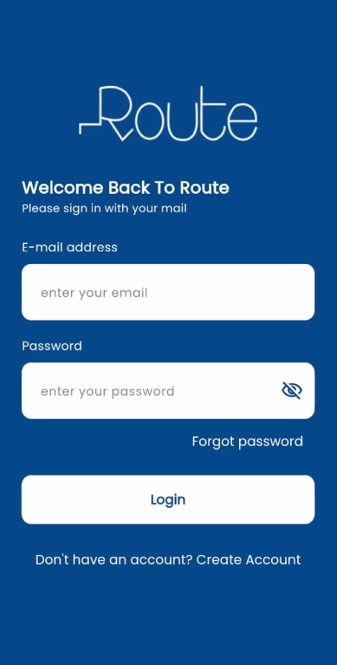
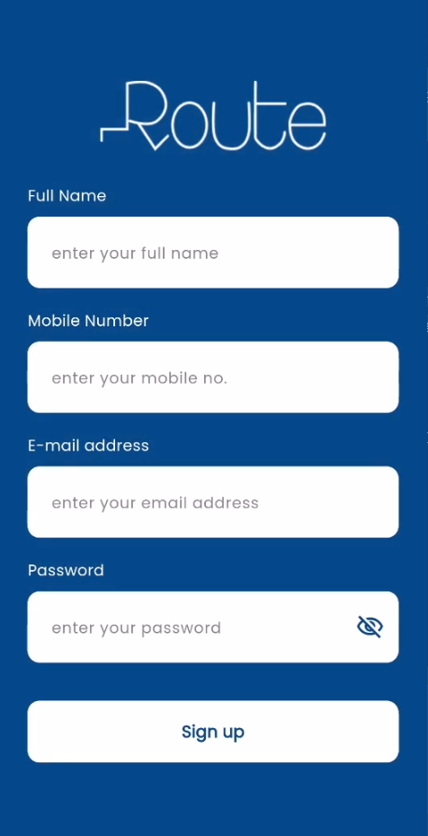
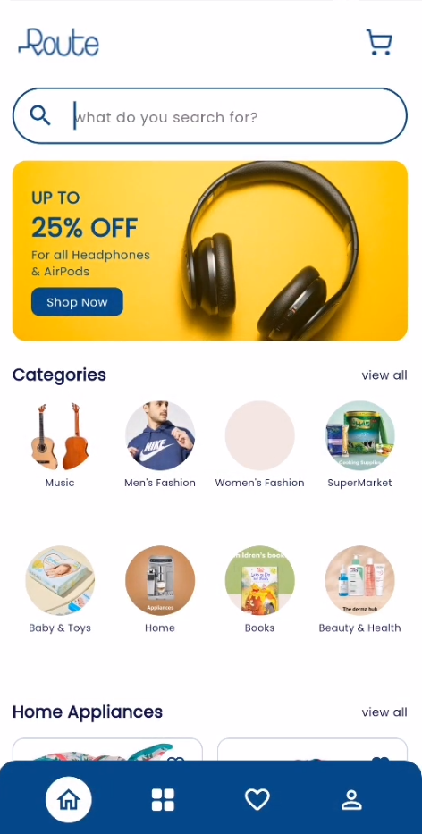
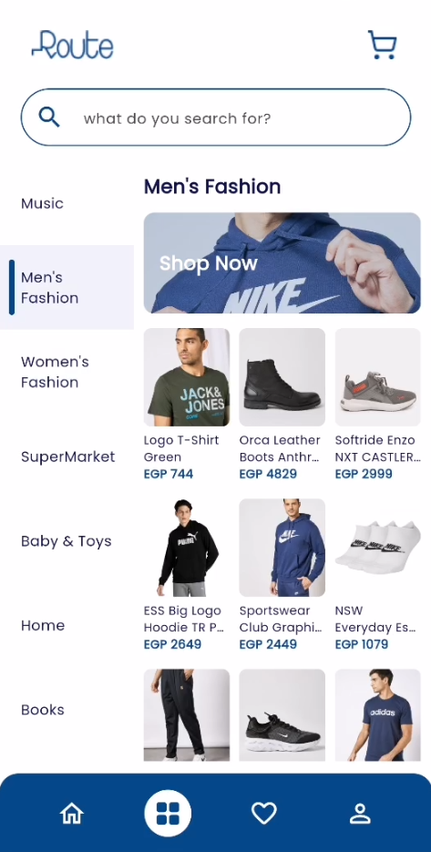
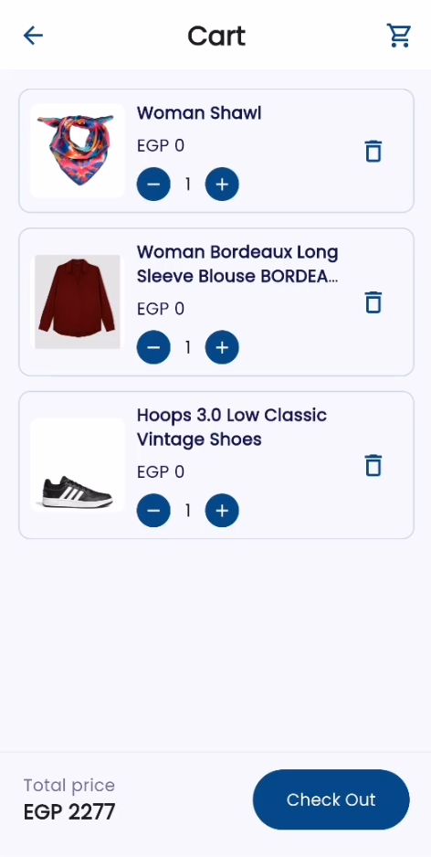
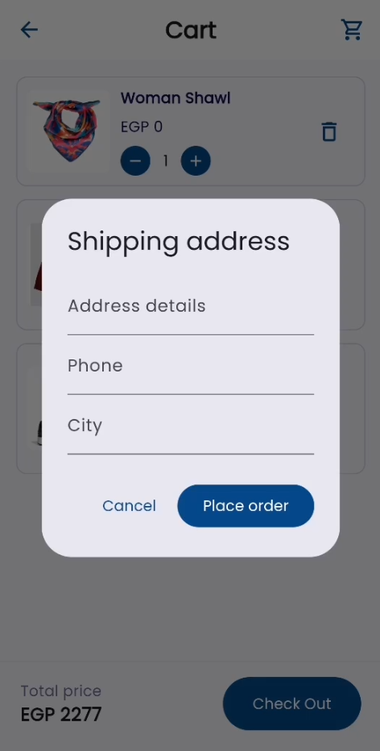
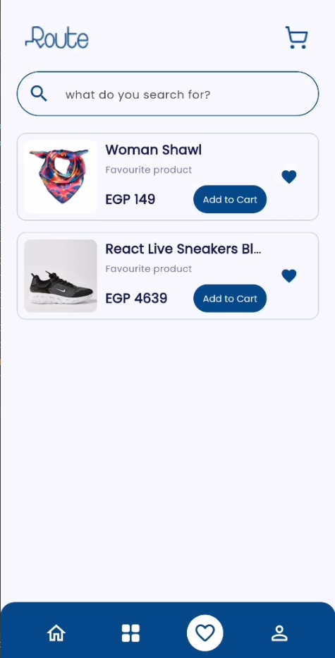
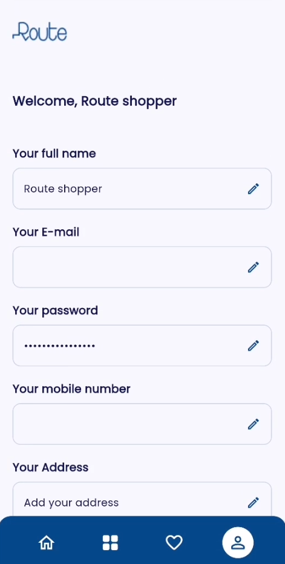

# Route E-Commerce App

A polished Flutter e-commerce application powered by the Route API. It offers an end-to-end shopping experience with authentication, browsing, category filtering, favourites, cart management, checkout, and local caching.

## Preview

### 1. Authentication

<p align="center">
  
  
</p>

### 2. Browse products

<p align="center">
  
  
</p>

### 3. Cart and checkout

<p align="center">
  
  
</p>

### 4. Personal area

<p align="center">
  
  
</p>

## Features

- Secure sign in and sign up with persistent sessions.
- Product discovery, category browsing, product details, and keyword search.
- Server-backed cart: add products, update quantities, remove items, and cash checkout.
- Server-backed wishlist with a dedicated favourites screen.
- Profile overview and sign out flow.
- Hive caching for cart and wishlist, with API refresh in the background.
- Responsive UI using `flutter_screenutil` and Poppins typography.

## Tech Stack

| Area | Technology |
| --- | --- |
| Framework | Flutter / Dart |
| State management | BLoC / Cubit (`flutter_bloc`) |
| Networking | `http` |
| Local persistence | Hive + SharedPreferences |
| API | [Route E-Commerce API](https://ecommerce.routemisr.com/) |
| UI | Google Fonts (Poppins), responsive layout |

## Architecture

The project follows a feature-first Clean Architecture / MVVM-inspired structure:

```text
lib/
├── app/                 # App bootstrap, theme, providers
├── core/                # Shared colors, assets, widgets
└── features/
    ├── auth/            # Authentication and session handling
    ├── categories/      # Categories and filtering
    ├── products/        # Products, search, details
    ├── cart/            # Cart and checkout
    ├── wishlist/        # Favourite products
    └── profile/         # User profile
```

## API Integration

The app integrates with Route API for:

- Authentication
- Products and search
- Categories
- Cart operations and checkout
- Wishlist operations
- User profile updates

## Getting Started

```bash
git clone https://github.com/rwasei74/E-commerce.git
cd E-commerce
flutter pub get
flutter run
```

> Ensure USB debugging is enabled when running on a physical Android device.

## Quality Checks

```bash
flutter analyze
flutter test
```

## Author

Built as a Flutter e-commerce project using the Route API.
